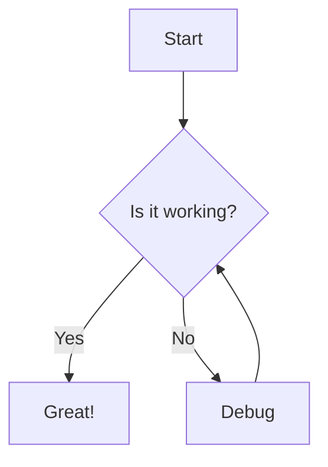
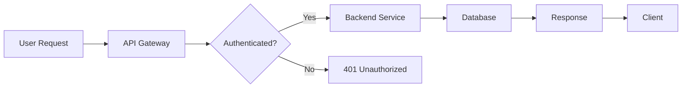
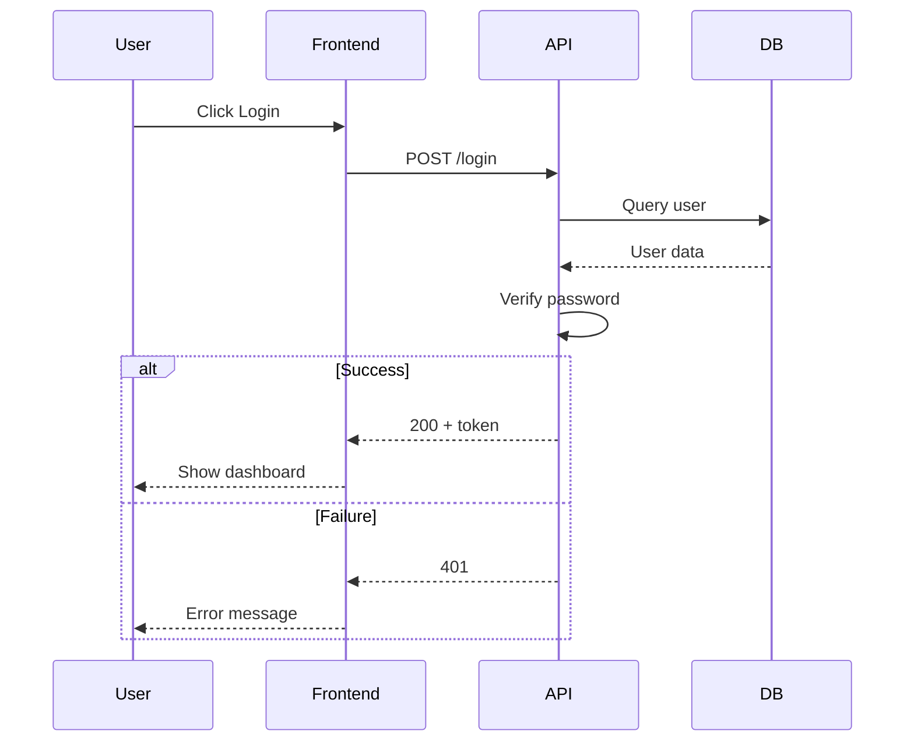
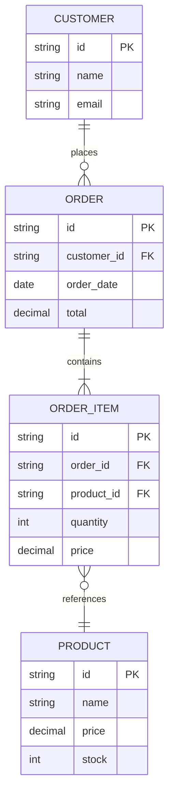
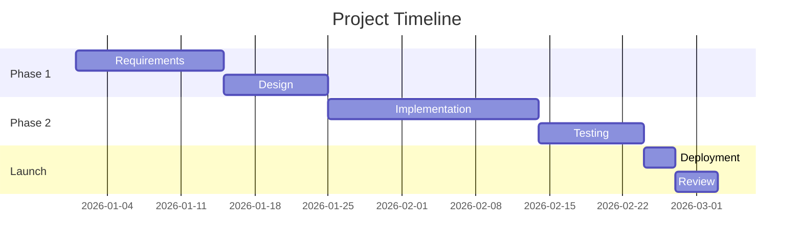

# Mermaid Diagram Skill

Generate diagrams from Mermaid text syntax. Outputs SVG, PNG, or interactive HTML.

## Diagram Types

| Type | Syntax | Use Case |
|------|--------|----------|
| Flowchart | `graph TD/LR/BT/RL` | Process flows, decision trees |
| Sequence | `sequenceDiagram` | Interaction sequences, API flows |
| Class | `classDiagram` | OOP class structures |
| State | `stateDiagram-v2` | State machines, lifecycle |
| ER | `erDiagram` | Entity relationships, data models |
| Gantt | `gantt` | Project timelines |
| Pie | `pie` | Proportional charts |
| Git | `gitGraph` | Git branch history |
| Journey | `journey` | User journey maps |
| Mindmap | `mindmap` | Idea hierarchies |
| Timeline | `timeline` | Event timelines |
| Requirement | `requirementDiagram` | Requirement tracking |
| Architecture | `architecture-beta` | System architecture (beta) |
| Sankey | `sankey-beta` | Flow quantities (beta) |

## How to Use

### Option 1: Generate HTML Preview (recommended)

Create a self-contained HTML file that renders the diagram via Mermaid CDN.
Open the file in any browser to view, zoom, and interact.

```bash
python3 scripts/render_mermaid.py --input diagram.mmd --output diagram.html --format html
```

### Option 2: Generate SVG / PNG via mermaid.ink

Use the mermaid.ink service to render server-side SVG or PNG.
Good for embedding in documents.

```bash
python3 scripts/render_mermaid.py --input diagram.mmd --output diagram.svg --format svg
python3 scripts/render_mermaid.py --input diagram.mmd --output diagram.png --format png
```

### Option 3: Inline Mermaid in Markdown

For README.md or documentation, just write fenced code blocks:



Most modern platforms (GitHub, GitLab, Notion, Obsidian) render these natively.

## Best Practices

1. **Start simple.** Begin with a minimal flowchart, then add detail.
2. **Use meaningful IDs.** `UserDB` not `node1`; makes the source readable.
3. **Keep diagrams focused.** One diagram = one message. Split complex flows into multiple diagrams.
4. **Label directions clearly.** For flowcharts, prefer `LR` (left-to-right) for horizontal flows, `TD` (top-down) for hierarchies.
5. **Add titles.** Use `---` title syntax to give context.

## Examples

### Flowchart



### Sequence Diagram



### ER Diagram



### Gantt Chart



## Troubleshooting

- **Syntax error?** Check for missing semicolons, mismatched quotes, or unclosed blocks.
- **Diagram too big?** Split into smaller diagrams or use subgraphs for organization.
- **mermaid.ink timeout?** Use HTML format (local CDN render) instead.
- **Not rendering in Markdown?** Verify the platform supports Mermaid (GitHub, GitLab do; some don't).

## References

- [Mermaid Official Docs](https://mermaid.js.org/)
- [Mermaid Live Editor](https://mermaid.live/)
- [mermaid.ink Service](https://mermaid.ink/)
