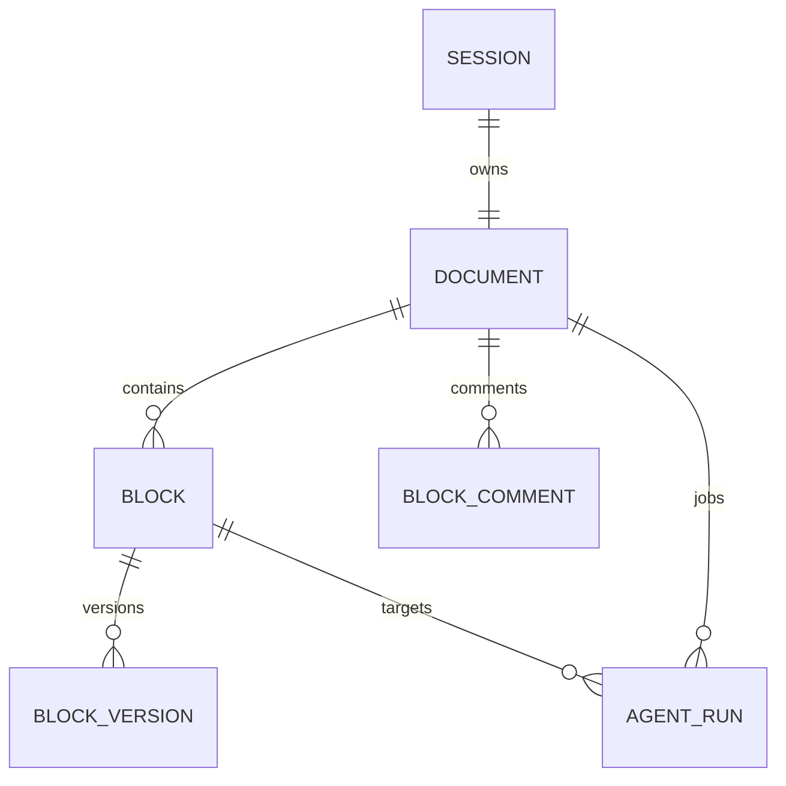

# Block PRD 模块代码与迁移说明

> 独立模块文档，最后更新：2026-09-15。适用于 `/prd-editor/:sessionId` 的 AI 接手、迁移、Provider 替换和重构；以当前源码与测试为准。

PRD 生成、关系图、设计系统、HTML 原型和 Spec 拆解的目标调用顺序见
[`prd-spec-skill-workflow.md`](prd-spec-skill-workflow.md)。

## 1. 模块定位

Block PRD 把一篇 PRD 拆成有层级、依赖和独立版本的 Block。用户可以逐块生成、编辑、审核、批注和恢复，也可以浏览/预览全文、执行跨模块审核，并让 AI 自动修订审核问题。

它是独立页面，由 `frontend/aios-main/src/App.tsx` 将 `/prd-editor/:sessionId` 路由到 `PRDEditor`。页面可刷新恢复，后台 AI 作业不依赖浏览器持续打开。

完整用户行为和历次验证记录见 [`block-prd-editor.md`](block-prd-editor.md)。本文件重点说明代码、状态边界与迁移方法。

## 2. 前端代码边界

目录：`frontend/aios-main/src/api/prd-editor/`

| 文件 | 责任 |
| --- | --- |
| `PRDEditor.tsx` | 页面协调器：打开文档、选中块、草稿、保存、SSE/轮询、模式切换 |
| `BlockTree.tsx` | 目录层级、块选择、批量选择和状态标识 |
| `BlockEditor.tsx` | 单块正文编辑/预览和固定视口布局 |
| `BlockToolbar.tsx` | 保存、生成、修订、审核和其他块动作 |
| `BlockHistory.tsx` | 历史版本比较和恢复 |
| `BlockCommentPanel.tsx` | 行级、多块批注及基于批注修订 |
| `FullDocumentView.tsx` | 全文文字/预览、审核、自动解决及问题定位回 Block |
| `GenerationStatus.tsx` | 首版连续生成和后台 AI 队列 |
| `api.ts` | Document/Block API 客户端 |
| `types.ts` | Snapshot、Block、Run、Review 等前端合同 |
| `editor.css` | 白绿色主题、约 70%–80% 视口编辑区、滚动和思维导图弹层 |
| `PRDEditor.test.tsx` | 主要编辑、保存、作业和全文模式回归 |

`PRDEditor.tsx` 当前掌握较多异步状态。拆分时不要先按视觉区域机械拆组件，应先明确“服务端快照、未保存草稿、运行中作业、已完成候选、全文模式”五类状态的所有权。

## 3. 后端代码边界

| 文件 | 责任 |
| --- | --- |
| `backend/app/api/documents.py` | 文档打开、大纲、导入、背景、提交、全文审核、自动解决和 SSE |
| `backend/app/api/blocks.py` | 块保存、历史、恢复、AI 作业、应用、取消、重试和批注 |
| `backend/app/services/block_service.py` | 事务、版本、依赖、批注、快照和 Spec 提交 |
| `backend/app/services/ai_service.py` | 作业调度、首版生成、版本保护、取消、全文审核和自动解决循环 |
| `backend/app/ai/provider.py` | Provider 抽象与结构化输入输出合同 |
| `backend/app/ai/codex_provider.py` | Codex CLI 调用、提示词和结果适配 |
| `backend/app/models/document.py` | 文档、revision、背景和全局规则 |
| `backend/app/models/block.py` | Block 结构、依赖和当前正文状态 |
| `backend/app/models/block_version.py` | 不可变正文版本 |
| `backend/app/models/block_comment.py` | 批注、目标块、目标版本和行范围 |
| `backend/app/models/agent_run.py` | AI 作业、请求键、输入基线、输出、状态和错误 |
| `backend/tests/integration/test_block_prd.py` | Block PRD 后端集成回归 |

`backend/main.py` 创建并连接 `BlockService`、AI service、Provider、ActorResolver 和 routers。更换数据库、队列或 Provider 时必须同步检查这个组合根。

## 4. 数据模型和版本规则



必须保留的不变量：

- 每个 Session 一份持续编辑的 Document。
- `document.revision` 表示文档结构、背景和全局基线；`block.version` 表示单块正文版本。
- 保存、恢复、应用候选都带期望版本；冲突时拒绝静默覆盖。
- 前端草稿不是服务端事实，但切换 Block、收到 SSE 或 AI 完成时不能丢失。
- Block 历史是追加式的；恢复旧正文会创建新版本，不回退版本号。
- 上游修改只把已有下游标记为待更新，不自动重写人工内容。
- 旧版本行批注不可直接套到新正文。
- 全文行范围必须映射回具体 Block、原始行号和目标版本。
- `AgentRun.input_snapshot` 是内部上下文，不通过 SSE 暴露给浏览器。

## 5. 文档 API

前缀：`/prd-documents`

| 方法 | 路径 | 用途 |
| --- | --- | --- |
| GET | `/templates` | 获取内置 PRD 模板 |
| POST | `/prd-documents` | 按 Session 打开/创建文档，可触发首版生成 |
| GET | `/{documentId}` | 获取完整编辑器快照 |
| PUT | `/{documentId}/outline` | 替换大纲 |
| POST | `/{documentId}/import` | 导入 Markdown、文本或 PDF |
| POST | `/{documentId}/plan` | AI 规划大纲 |
| PUT | `/{documentId}/context` | 更新背景与全局规则 |
| POST | `/{documentId}/submit` | 确定性汇总并提交评审 |
| POST | `/{documentId}/review` | 创建全文审核作业 |
| POST | `/{documentId}/review/{reviewRunId}/resolve` | 自动修订审核问题并复审 |
| GET | `/{documentId}/markdown` | 导出 Markdown |
| GET | `/{documentId}/events` | SSE 持久化快照流 |

`POST /prd-documents` 的前端调用默认传 `auto_generate: true`。只有从未生成正文、无人工编辑历史且满足服务端资格的新文档才自动领取首版任务；重复打开、刷新和多页面不会重复生成。

## 6. Block API

前缀：`/prd-documents/{documentId}`

| 方法 | 路径 | 用途 |
| --- | --- | --- |
| PUT | `/blocks/{blockId}` | 乐观并发保存正文、标题、依赖等 |
| GET | `/blocks/{blockId}/history` | 获取历史版本 |
| POST | `/blocks/{blockId}/restore` | 将历史正文恢复为新版本 |
| POST | `/blocks/{blockId}/runs` | 创建 generate/revise/review 作业 |
| POST | `/runs/{runId}/apply` | 将候选应用到当前 Block |
| POST | `/runs/{runId}/cancel` | 取消作业 |
| POST | `/runs/{runId}/retry` | 用新请求键重试 |
| POST | `/comments` | 创建全文行级或多块批注 |
| PATCH | `/comments/{commentId}` | 修改批注解决状态 |

AI 结果通常先保存为候选。页面仅在没有未保存输入且基线仍匹配时自动应用；显式应用也必须检查当前版本。

## 7. 前端保存与刷新

- 每个 Block 的草稿保存在 React 状态中，切换 Block 仍保留未保存内容。
- 输入停止约 900 ms 后自动保存，也可以手动保存。
- 保存请求携带 `expected_version`；失败显示原因且不丢弃草稿。
- SSE 推送服务端持久化快照，5 秒轮询作为兜底。
- 合并新快照时必须优先保护用户未保存输入，不能用后台结果直接覆盖。
- 全文模式进入前先保存草稿；“更新全文”重新建立全文和 Block 行号映射。

## 8. AI 作业体系

作业类型包括：`initial`、`plan`、`generate`、`revise`、`review`、`document_review`、`document_revision`。

单块生成/修订只提供当前块、当前反馈、文档背景/规则和必要上游摘要。全文审核才提供全部模块正文。Provider 返回结构化结果，service 校验 Block ID、基线版本、输出形状和作业状态。

运行约束：

- 单后端进程，AI 总并发最多 3 个；
- 同一个 Block 同时只能有一个活动作业；
- 请求键用于领取和重试幂等；
- 页面关闭不取消后台任务；
- 取消/关闭要回收 CLI 子进程；
- 服务重启把未完成作业标记为 `PROCESS_INTERRUPTED`。

当前 SQLite 与进程内协调器不支持直接启多个 Uvicorn worker。横向扩容前需要外部队列、分布式锁和可恢复 worker ownership。

## 9. 全文审核与自动解决

全文审核 `document_review` 读取一个明确的 document revision 和所有 Block 版本，返回摘要、问题级别、建议及相关模块。它本身只读，不修改正文。

审核结果引用的模块必须是当前文档中存在的合法 Block ID。Provider 返回不存在的模块时，后端拒绝保存报告，避免页面产生无法定位的问题。Provider 迁移时必须针对模块 ID 做结构化约束和校验重试，而不是靠自然语言猜测标题。

“自动解决审核问题”流程：

1. 校验原审核作业属于当前文档，并读取最新可用文档基线。
2. `resolve_document` 根据结构化问题修订相关 Block。
3. 在内存中对候选正文复审，确认剩余问题和需要继续修改的章节。
4. 检查并发冲突后，通过正常版本流程应用修订并保留历史；复审结果写为最新 `document_review`。
5. 如果复审仍有阻断项，最多再进行一轮定向“修订 → 复审”（总计不超过两轮）；普通警告保留在复审报告中，没有正文改动时停止并保留问题。
6. 页面以最后一次复审报告作为新基线，不继续展示旧报告。

循环上限用于防止无限调用。真正需要产品决策的问题允许保留。提示词要求只修改面向用户的 PRD 内容，不把内部 Block 编号、依赖元数据或编辑器实现说明写入正文；非关键缺失决策采用保守且明确的默认值。

## 10. 权限、安全与提交

- 所有接口经 `ActorResolver` 校验项目审批人、经理或负责人权限。
- 浏览器不自行伪造最终身份。
- 全文过大时明确拒绝，不静默截断。
- 提交评审由 `BlockService` 确定性汇总正文与结构片段，检查完整性、需求 ID、验收引用和现有规格规则。
- 当前版本的全文审核没有 blocker/warning 时，右上角“进入下一阶段”可将文档提交到 `HUMAN_REVIEW`。若逐块结构化抽取仍产生重复 ID、验收映射等机械性问题，以这次未过期的全文审核作为通行凭证；原始结构发现保留在提交审计事件中，不再二次阻断用户。
- 提交只创建 `HUMAN_REVIEW` SpecVersion，不自动批准、拆分或发布。
- 旧 Gitea 评论与新 Block 批注分别保存，不能在迁移时混成同一数据表而丢失语义。

## 11. 独立迁移清单

迁移 Block PRD 至新工程至少需要：

- 整个前端 `prd-editor/` 目录及统一 API 客户端适配；
- Document、Block、BlockVersion、BlockComment、AgentRun 模型和迁移；
- `documents.py`、`blocks.py`、`block_service.py`、`ai_service.py`；
- `provider.py` 的结构化合同及一个 Provider 实现；
- Session/SpecVersion/ActorResolver 的适配接口；
- SSE 或等价持久化作业状态通道；
- `test_block_prd.py` 和前端编辑器测试。

推荐迁移顺序：只读打开文档 → 人工保存与历史 → 批注 → 单块 AI → SSE/后台恢复 → 全文审核 → 自动解决 → Spec 提交。每一步保持旧数据可读，不要同时更换页面框架、数据库和 AI Provider。

## 12. 重构重点

- 从 `PRDEditor.tsx` 抽出草稿状态机、快照合并、作业 selector 和全文行号映射。
- 将 Provider 输入输出合同与提示词版本化；提示词升级不应改变 HTTP DTO。
- 将后台作业协调从进程内 service 抽出时，先保留现有幂等键和版本保护。
- 把主站设计 token 共享给编辑器，保持白底、绿色主操作和浅色边框，避免重新出现孤立深色主题。
- 思维导图保持缩略图入口和按原始比例展开的弹层，不再占据整页宽度。

## 13. 风险与验收

主要风险：未保存草稿被快照覆盖、旧审核报告一直被当成最新、非法模块引用、AI 修订绕过版本历史、SSE 和轮询重复刷新、多 worker 重复领取、全文行号定位漂移。

最小验收：

- 路由可直接打开、刷新恢复并返回项目；
- 自动保存无人工拉伸控件，编辑/预览区约占可见页面 70%–80%，按钮仍可见；
- 浏览全文有内容，文字/预览模式高度稳定；
- 审核问题点击后返回分块模式并定位到目标 Block；
- 修改并更新全文后，新审核不会继续错误提示旧版本；
- 自动解决创建新版本并展示最后复审报告；
- 并发冲突、取消、非法模块引用和服务重启均有明确结果。

针对性验证：

```powershell
npm --prefix frontend/aios-main test -- --run src/api/prd-editor/PRDEditor.test.tsx
npm --prefix frontend/aios-main run lint
backend/.venv/Scripts/python.exe -m pytest backend/tests/integration/test_block_prd.py -q
```

若只迁移文档或样式，可按风险缩小验证范围；涉及版本、AI 作业或提交时必须运行后端集成测试。
