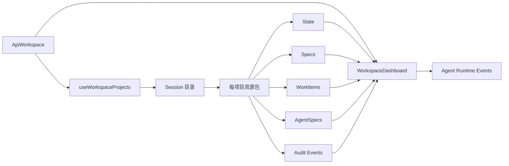

# Dashboard 模块代码与迁移说明

> 独立模块文档，最后更新：2026-09-15。适用于 Dashboard 的 AI 接手、拆分、迁移和重构；以当前源码与测试为准。

## 1. 模块定位

Dashboard 是主工作台 `ApiWorkspace` 的一个标签页，并非独立 URL 应用。它把多个项目已有的 Session、规格、任务、Agent 运行和审计数据聚合为管理视图，本身不拥有新的业务状态，也不负责决定工作流是否合法。

主要展示：

- 项目总数、进行中项目和任务完成进度；
- Agent 数量、运行状态和 token 使用；
- 当前用户需要处理的审核、审批和被指派未完成事项；
- 项目阶段、规格状态、最近活动和审计通知；
- 跳转到项目、工作项、全部项目和工作空间的入口。

## 2. 代码边界

### 前端

| 文件 | 责任 |
| --- | --- |
| `frontend/aios-main/src/api/ApiWorkspace.tsx` | 主工作台容器、标签、Session 选择、命令、轮询及视图协调 |
| `frontend/aios-main/src/api/WorkspaceDashboard.tsx` | Dashboard 展示、统计、待办、项目卡片与通知派生 |
| `frontend/aios-main/src/api/useWorkspaceProjects.ts` | 项目目录、当前项目资源包、刷新和状态防倒退 |
| `frontend/aios-main/src/api/sessions.ts` | Session、Spec、WorkItem、生命周期、Runtime 和 Event API 客户端 |
| `frontend/aios-main/src/api/WorkspaceDashboard.test.tsx` | Dashboard 渲染与交互回归 |
| `frontend/aios-main/src/api/workspace.test.tsx` | 主工作台跨视图和工作流回归 |

### 后端依赖

Dashboard 没有专用 `/dashboard` 接口。它依赖现有 Session 资源接口，主要数据包括：

- Session 目录与单个 Session 状态；
- Specs、WorkItems、AgentSpecs、Audit Events；
- Agent runtime 和 runtime events；
- 后端计算的 `legal_actions`、阶段和状态版本。

相关路由和 service 从 `backend/main.py` 的组合根开始追踪。Dashboard 只读聚合，不应为了页面方便绕过 command service 或直接改变状态机数据。

## 3. 数据流



`useWorkspaceProjects` 获取 Session 目录后，为每个项目并行读取 state、specs、work items、agent specs 和 events；批量加载最多 4 个项目并发。Dashboard 再读取 runtime 和 runtime events，用于 Agent 与 token 统计。

## 4. 状态所有权与不变量

- 当前 Session ID 存在浏览器 `localStorage`：`firstflight.active-session-id`。
- 项目资源包由 `useWorkspaceProjects` 管理，Dashboard 只消费并派生 ViewModel。
- Session 状态响应带 `state_version`；客户端拒绝让较旧响应覆盖较新状态。
- token 数据从 `turn.completed` 等 runtime events 归集，不是独立账本。
- 待办由根级审核/审批、当前用户指派和未完成状态派生。
- 阶段流转、权限和允许操作必须以后端状态及 `legal_actions` 为准。
- 单个项目加载失败不能清空其他已经成功加载的项目。
- 审计事件是历史证据，不是可编辑业务对象。

## 5. 对外接口形态

实际方法集中在 `frontend/aios-main/src/api/sessions.ts`，覆盖：

- 创建、列出和读取 Session 状态；
- 读取 Specs、WorkItems、AgentSpecs 与 Events；
- 选择 Agent backend；
- 推荐/选择生命周期路线；
- 读取 Agent runtime 与 runtime events；
- 提交命令、查询命令作业和自动修复；
- 执行工作项审核、审批及其他合法动作。

迁移时应以该客户端和当前 OpenAPI 为准，不要根据 Dashboard 组件中的使用方式反推并硬编码接口。

## 6. 适合的拆分顺序

`ApiWorkspace.tsx` 当前同时承担布局、网络协调、命令执行和多条业务流程，是 Dashboard 最大的耦合来源。推荐顺序：

1. 把统计、待办、通知、进度等纯派生逻辑抽成 selector，并先补测试。
2. 把多项目加载封装成独立 query/hook，保留并发限制、取消与 `state_version` 保护。
3. 定义稳定的 Dashboard ViewModel；展示组件只接收数据和导航回调。
4. 再从 `ApiWorkspace` 中抽离 Dashboard controller，不同时改动状态机行为。
5. 如新增后端聚合接口，短期并行比较新旧结果，确认一致后再删除前端聚合。

## 7. 独立迁移清单

迁移 Dashboard 至新工程至少需要：

- 本文件“代码边界”列出的前端文件或等价实现；
- `sessions.ts` 使用到的 DTO、错误处理、请求取消和基础 API 客户端；
- Session/Spec/WorkItem/Agent/Event/Runtime 的后端合同；
- 当前用户身份与项目导航适配层；
- 主站设计 token 或等价白绿色组件；
- Dashboard 与工作台相关测试夹具。

不要把整个 `ApiWorkspace.tsx` 原样复制成新 Dashboard。先通过适配层提供所需数据，再逐步抽离页面，可显著降低对聊天、看板和命令流程的耦合。

## 8. 风险与验收

主要风险：项目数增长导致多请求首屏变慢、runtime 事件重复统计、旧响应覆盖新状态、前端重新实现业务权限、一个失败请求拖垮全部卡片。

最小验收：

- Dashboard 能在主工作台打开并刷新；
- 多项目卡片、进度、待办、Agent 和 token 统计可显示；
- 一个项目失败时其他项目仍保留；
- 较低 `state_version` 不覆盖较高版本；
- 点击项目/工作项跳到正确目标；
- `WorkspaceDashboard.test.tsx` 和相关 `workspace.test.tsx` 用例通过。

针对性验证：

```powershell
npm --prefix frontend/aios-main test -- --run src/api/WorkspaceDashboard.test.tsx src/api/workspace.test.tsx
npm --prefix frontend/aios-main run lint
```
