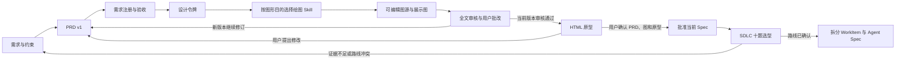

# PRD、关系图、原型与 Spec 拆解的 Skill 工作流

本文件规定产品创作顺序和 Skill 选择，不替代软件交付生命周期计划。正式拆解仍以
[`sdlc/README.md`](sdlc/README.md) 和 `backend/rules/sdlc/` 中的规则为准。

## 核心判断

先用合适的绘图 Skill 生成**语义上正确、可编辑的图源**，再按设计系统统一呈现，是合适的。
`design-system` 的主要作用是从现有产品界面提取颜色、字体、间距等设计令牌，并在出图后
审查一致性；实际绘制和版式调整由 `mermaid-skill`、`drawio-skill` 或 `diagram-design` 完成。
因此设计令牌应在出图**之前**确定，在出图**之后**复核，不把它当作修改已压平图片的工具。

## 调用顺序

| 环节 | 主要 Skill | 输入与输出 | 进入下一环节的条件 |
| --- | --- | --- | --- |
| 需求输入 | `spec-driven-development` 用于辨认模糊点；无须每次调用 | 用户原话、范围、约束、资料、未决问题组成 Brief | 未知仍标为未知，不代替用户决定 |
| PRD v1 | `create-prd` → `deliver-acceptance-criteria` | 从 Brief 生成有版本号的整篇 PRD 和可验证验收条件 | 每项重要行为有来源或明确假设 |
| 需求整理 | `requirement-registry-skill` | 形成唯一 FR/NFR 注册表，稳定编号并合并语义重复项 | 需求与验收条件能互相引用 |
| 视觉基线 | `design-system` 的提取模式 | 从现有前端样式提取图形令牌：背景、文字、强调色、状态色、线条、字号、间距 | 令牌与当前 PRD 页面一致；不凭空换品牌 |
| 关系图初稿 | 按下表每张图选一个主绘图 Skill | 图形意图、关联 FR/NFR、节点和关系、可编辑图源 | 图上的事实均能回到 PRD 证据 |
| 呈现与复核 | 展示要求高时用 `diagram-design` 排版；用 `design-system` 审查一致性 | 图源保持可编辑，另产出适合文档阅读的展示图 | 标签、对比度、层级、密度和正文术语一致 |
| PRD 修订 | `prd-consistency-skill`、`prd-critique`、`traceability-skill`；必要时重跑注册表 | 全文审核意见进入右侧文档，用户在 Agent 对话框下达修改指令 | 阻断性冲突已解决；每次生成或改动形成一个新版本 |
| HTML 原型 | 已确认的 PRD 版本；界面实现时参考 `frontend-ui-engineering` 和设计令牌 | 版本绑定的可交互 HTML，覆盖主要流程和空、错、加载状态 | 用户看过并确认 PRD、图与原型 |
| Spec 拆解 | `planning-and-task-breakdown`、`deliver-acceptance-criteria`、`traceability-skill` | 从已批准 Spec 拆出 WorkItem、Agent Spec、依赖、责任人及验收 | 完成 SDLC 选型、详细规划和独立审核后才能落库 |

`SpecVersion` 是获批的项目需求基线；拆解产物是 WorkItem 和子 Agent Spec。PRD 内容无冲突
只是进入人工确认的必要条件，不自动等于获批，也不自动启动拆解。

## 微场景小流程

2026-10-07：默认采用按需审核。生成和局部改写不再追加独立质量审核调用；“自动解决审核问题”
默认只修订一次，修订后标记待手动复审。用户点击“审核全文”才开始审核；点击“进入下一阶段”
时，若当前版本尚未通过审核，则弹窗确认，按需保存草稿、同步改动章节的需求结构并审核全文。
审核不会自动提交到下一阶段，用户查看结果后继续。以下提及一致性 Skill 的写作约束可在同一次
改写调用中使用，不表示每次修改后必须另起审核作业。

Agent 对话框是通用入口；明确指定的其他目标优先，未指定时以当前打开的 PRD 和选中
Block 为上下文。对 PRD 发出的单 Block 指令先识别修改对象，再选择下面最小的 Skill
组合。选中行是优先锚点；无选中行时按用户写明的段落、图名或当前 Block 定位。

| 用户动作 | 小流程与 Skill | 修改范围及后续检查 |
| --- | --- | --- |
| 修错字、标点、语气或仅润色一句 | `create-prd` 一次局部改写 | 保持事实、FR/NFR 编号和其他段落；不重跑全文审核 |
| 改选中段落的普通说明 | `create-prd` → 同一次调用内用 `prd-consistency-skill` 检查 | 只改目标段及必要相邻句；保留当前 Block 其余内容 |
| 修改需求、权限、数值、状态或验收 | `create-prd` + `deliver-acceptance-criteria` + `requirement-registry-skill` + `traceability-skill` | 同步目标需求与直接关联的验收和标识；影响其他 Block 时标记待更新，等用户主动触发审核 |
| 修改 Markdown 表格单元格、行列或排序 | Agent 只定位表格与参数；表格解析器精确执行，不为纯数据操作加载写作 Skill | 预览改单元格、增删行列或排序结果；不重写整个章节 |
| 移动段落、调整目录顺序或章节层级 | Agent 给出原文与目标位置或章节 ID；确定性移动并校验目录无循环 | 多处目录位置在同一事务更新，全文只增加一个版本 |
| 一条指令同时修改多个章节 | 涉及需求语义时用 `create-prd`；多章节再加 `prd-consistency-skill`，随后执行精确修改 | 预览全部受影响章节；一次应用、一份全文版本，版本冲突时整体拒绝 |
| 修改 Mermaid 配图或新画局部流程图 | `mermaid-skill` → `design-system` 视觉审查；明确要求精美排版时追加 `diagram-design` | 更新可编辑 Mermaid 图源与必要图注；在页面本地渲染，不调用远程渲染 |
| 修改已有 draw.io ER 图 | `drawio-skill` → `design-system`；精美排版时可参考 `diagram-design` | 带入现有图源，保留稳定图 ID；只改有证据支持的实体、字段或关系 |
| 新增或替换普通产品配图 | `diagram-design` 生成自包含 SVG；已配置图片服务时调用 `generate_image` 生成位图 | 先预览新图，再保存为 PRD 图片资产并插入或替换引用；保留相邻图注。事实性架构图仍走可编辑 Mermaid/draw.io 路线 |
| 批量统一术语或表格用词 | Agent 一次解析查找、替换、范围和例外；确定性扫描并列出命中 | 逐项勾选后一次应用为一个全文版本；代码块、图源、链接、引用原文及明确排除的章节不会被误改 |
| 调整数据图表 | 先核实原始数据和单位，再选择图表工具与样式审查 | `chart-visualization` 会向外部服务传数据；私有内容未明确授权时不自动调用 |
| 修改整篇、跨章节或目标不明确 | 确认范围后修订，审核按需触发 | 保留修改候选和影响说明；注册表、一致性、批判性与追溯审核由用户主动启动 |
| 只修改 HTML 原型的视觉或交互 | `frontend-ui-engineering` + `design-system`；从当前 PRD 版本重新生成衍生原型 | 不把原型里的想法倒写成获批需求；若行为变更，先回 PRD 新版本 |
| 冻结 PRD 后制作产品演示 PPT | `ppt-generation` 规划页序与叙事 → PRD 原文证据校验 → `officecli-skill` 生成并检查可编辑 PPTX | 团队讲解版与对外介绍版分开保存；只引用当前冻结版本，不改 PRD，也不启动 Spec 拆解 |
| 已批准 Spec 的局部变更 | 先按所选 SDLC 模型做变更影响分析，再用相关 PRD/拆解 Skills | 更新基线、受影响任务与门禁；不能绕过批准直接改执行计划 |

同一个局部入口还有几种无需重跑整篇生成的处理方式：

- **只改图注或图片旁的文字**：走文本小流程，保留原图源和图片引用。
- **从现有段落补一张图**：先提取该段已经确认的角色、步骤或对象，再选 Mermaid 或
  draw.io；`design-system` 检查其样式，随后核对图与段落是否表达同一规则。
- **删除过时的图**：先确认相应需求已经删除或改写，再删除图源、展示引用和图注；
  不能因图难看就丢失仍有效的需求信息。
- **根据一条批注修改**：以批注关联的 Block 和行范围为锚点，按文字、需求或图源分类；
  候选改动与原文比较后再应用，不把同一问题扩大成整篇重写。
- **恢复历史版本**：走版本恢复而非生成 Skill；恢复作为新版本保存，并重新标记关联
  图和原型的有效性。
- **旧基线或任务失败后重试**：先检查 Block 版本和依赖版本；发生冲突时要求基于当前
  版本重试，不将旧 Agent 输出静默覆盖新内容。

单 Block 修订入口已经按文本润色、局部说明、需求变更、Mermaid、draw.io 和普通配图
选择 Skill；局部修订只做一次 Agent 调用。表格、目录移动、已明确目标的
多章节修改与可编辑配图修改则生成结构化预览，一次应用为一个全文版本。Mermaid 图源在
预览中本地渲染并于应用前校验语法；draw.io ER 图保留图 ID 与可编辑 XML，在预览中显示
实体增删。图文联动时，同一份修改方案包含必要的正文、表格和图源操作，并列出相关章节的
检查结论。`design-system` 仅在要求美化或统一视觉时加入，避免每次局部微调重复调用。
未指明章节的全文修改仍要求
用户先明确目标。右侧阅读高亮
或源码选区会传入左侧 Agent 指令，作为局部编辑的行范围。每次成功应用仍按 PRD 版本
规则记录，失败不能覆盖当前内容。普通配图使用现有图片资产存储；未配置 `IMG_GEN_URL`
时采用本地可编辑 SVG 示意图，配置后经 `generate_image` 图片 Skill 使用上游位图生成。
图表外部服务和原型局部编辑还需要各自的资产或页面执行入口，不能因为 Skill 已可加载
就称为自动完成。

## 冻结 PRD → 产品演示 PPT

这是一条按需触发的衍生产物小流程，与 HTML 原型使用同一个已提交的 `SpecVersion`。
PRD 页面在当前正文已提交时开放“生成 PPT”；项目顶层页在存在冻结版本时开放团队版、
对外版入口。相同版本、相同受众的再次操作直接下载已保存的 PPTX；PRD 更新后使用
新版本重新生成，不把旧 PPT 冒充当前内容。

1. **取证与分流**：读取冻结 PRD 的版本号、正文和内容哈希。用户选择“团队讲解”或
   “对外介绍”；两版均不使用未保存草稿、未批准的实现结果或 HTML 原型中的推测。
2. **`ppt-generation` 规划**：只加载它来规划 5–9 页的故事线、页标题、每页一个结论、
   少量要点和讲者备注。团队版强调问题、用户、范围、主流程、验收与未决事项；
   对外版强调用户价值、场景和 PRD 已确认的能力，不把内部实现、风险或未批准路线写成宣传承诺。
3. **证据核对**：关键页带 PRD 原文短引。后端检查引文确实存在于该冻结版本；失败时
   要求 Agent 修正，而不把无证据的数字、客户、上线日期或市场地位写入 PPT。
4. **`officecli-skill` 制作与检查**：先验证项目内 Skill 文件摘要，再用本地 CLI 生成
   可编辑的 PPTX 文本和形状，并运行 Office 格式检查。两版使用各自统一的配色与排版。
   项目内 `ppt-generation` 自带的逐页图片脚本依赖尚未安装的图片生成 Skill 和
   `python-pptx`，本流程不调用该脚本；因此正文保持可编辑。
5. **保存与下载**：按冻结版本和受众分别保存文件与哈希。PPT 生成失败不改变 PRD、
   原型或审核状态；对外版由用户审阅后自行分享，系统不自动发布。

`design-system` 适合从代码库提取或审查整套视觉令牌，这里没有把它当成每次 PPT
生成的强制步骤。需要品牌级改版时先独立建立设计令牌，再把确认后的颜色与字体交给
PPT 制作步骤。

## 每张图如何选择

| 需求 | 主绘图 Skill 与保留的图源 | 呈现处理 |
| --- | --- | --- |
| 流程、时序、状态、用户旅程、模块依赖的快速说明 | `mermaid-skill`，保留 Mermaid 文本 | 在 Block PRD 页面本地渲染；按设计令牌配置颜色；需要精美展示时交给 `diagram-design` |
| 数据实体关系、需要持续修改的架构图 | `drawio-skill`，保留 `.drawio` / XML | 用设计令牌统一节点、连线与标签；结构化 Project Spec 当前只接受这种形式的 ER 图 |
| 对外演示、复杂关系或高质量阅读图 | 先保留 Mermaid 或 draw.io 的语义图源，再用 `diagram-design` | 输出自包含 HTML/SVG；`design-system` 做视觉复核，不能改变图的事实 |
| 有真实数值的数据分析图 | `chart-visualization`，保留数据、图表规格和来源 | 先核实数字与单位；其脚本向外部服务发送数据，私有 PRD 未获明确授权时不调用 |

一张图只选与问题匹配的主 Skill，不为了用满工具而重复生成。没有足够证据时不画图；
不推测实体字段、基数、调用顺序、时间或统计值。每张图保存标题、用途、关联需求 ID、
图源、展示产物和所依附的 PRD 版本。修改正文中的事实后，先改图源再重新出展示图。

`mermaid-skill` 的远程渲染和 CDN 路线不用于默认 PRD 流程。当前 Block PRD 前端已有本地
Mermaid 渲染器，可以直接使用图源。普通配图仅在用户明确发出生成指令后调用已配置的
图片服务；其他图表外部服务仍须在传输私有需求数据前获得明确授权。

## 版本与确认门禁

1. 用户的原话、Agent 命令、批注、全文审核和结果可追溯；当前页面内容是默认指令上下文，
   但 Agent 对话框仍接受针对项目其他部分的明确命令。
2. 每次生成或改动 PRD 都产生**一个新的整篇版本**，记录版本号和具体修改时间；不按
   章节或 Block 单独计版本。人工草稿仍须明确保存，不能因 Agent 完成而静默覆盖。
3. 图源、HTML 原型和产品演示 PPT 绑定其输入 PRD 版本。旧版本只读；新版本改变相关
   需求时，旧衍生产物不冒充当前版本。
4. 全文审核检查语义重复、跨章节冲突、图文不一致、FR/NFR 到验收的覆盖，以及来源到
   WorkItem/Agent Spec 的追溯。用户有权接受有记录的开放问题；Agent 不伪造批准。
5. PRD、关系图、HTML 原型分别可查看。三者由用户确认后批准当前 Spec，再**单独**确认
   是否开始拆解。拆解前依据获批内容回答 SDLC 十题；未知不当作否，选型冲突先澄清。
6. 拆解遵守所选模型的阶段编号、交付物、责任人、排期及准出任务依赖。生成计划不代表
   阶段已经开始，也不代表签字、测试或上线已完成。

## 当前产品边界

- Block PRD 已支持 Mermaid 代码块的本地预览和普通 SVG 配图资产；结构化 Project Spec 的
  合同当前只接受 draw.io ER 图。普通 SVG 配图不能伪装成 ER 图写入结构化 Spec；
  `chart-visualization` 输出尚无自动写入结构化 Spec 的字段或前端嵌入流程。
- `design-system` 可以指导配色与审查；项目还没有把其令牌自动传给所有绘图器。实施
  自动美化时，应以现有 `frontend/aios-main/src/api/prd-editor/editor.css` 的最终生效样式
  为基线，并把同一组令牌传给 Mermaid、draw.io 和 `diagram-design`。
- 当前界面存在将“确认 PRD”与“开始拆解”串联的路径；交互调整时要按上面的两个确认门禁
  拆开。此文件记录目标工作流，不把尚未接入的自动化描述为已上线能力。

## PRD 优化工作台的微场景（2026-10-07）

| 入口 | 处理方式 | 写入边界 |
| --- | --- | --- |
| 需求影响 / 文档健康 | 读取依赖、需求编号、审核和冻结产物版本，确定性计算，不调用模型 | 只更新位置索引，不写正文 |
| 受影响内容复审 | 用户手动触发，按变化与依赖缩小质量检查范围；全局编号、术语、引用和规则独立检查 | 只保存报告，不能作为完整审核门禁依据 |
| A/B 方案 | 两路独立 `plan_chat_edit`，每路复用已安装微场景 Skill；分别持久化，允许单路重试 | 用户选择后进入原有预览，确认应用才新增全文版本 |
| 已确认答案 / 定向图文更新 / 稳定位置 | 汇总用户确认输入，复用 `plan_chat_edit`，验证范围、原文与版本 | 人工草稿先保存，候选先预览，冲突不覆盖 |
| 会议包 | 两版快照对照 + 当前带来源的审核/待决事项，直接生成 Markdown | 不调用模型、不批准、不改正文 |

稳定位置仅继承无歧义的唯一原文，不做模糊定位；已确认问题记录不会清除正式审核的待处理结论。
