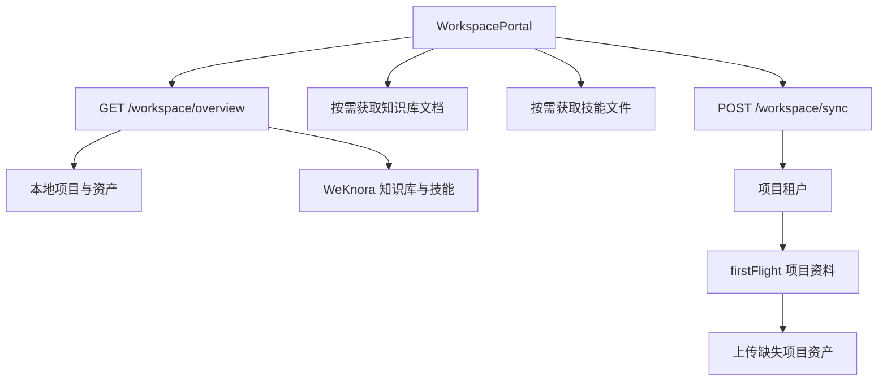

# 工作空间模块代码与迁移说明

> 独立模块文档，最后更新：2026-09-15。适用于 `/workspace` 页面及其 WeKnora 集成的 AI 接手、迁移和重构；以当前源码与测试为准。

## 1. 模块定位

工作空间是独立页面，入口为 `/workspace`。它将本地项目资产与 WeKnora 的知识库、技能整合到一个只读浏览和同步入口中，与主工作台 Dashboard 解耦。

页面包含三个区域：

- 空间：个人空间、项目共享空间、PRD/原型/代码等资产、文件和存储信息；
- 知识：知识库搜索、选择和文档列表；
- 技能：技能搜索、选择和文件列表。

同步按钮把本地项目资料发送到对应项目租户的知识库。读取路径允许远端离线降级，写入同步必须明确报告失败。

## 2. 路由与代码边界

`frontend/aios-main/src/App.tsx` 识别 `/workspace` 后直接渲染 `WorkspacePortal`，不进入 `ApiWorkspace`。

| 文件 | 责任 |
| --- | --- |
| `frontend/aios-main/src/api/WorkspacePortal.tsx` | 页面标签、选择、搜索、同步、加载与错误状态 |
| `frontend/aios-main/src/api/workspacePortalApi.ts` | DTO 和 Workspace API 客户端 |
| `frontend/aios-main/src/api/WorkspacePortal.test.tsx` | 加载、切换、同步和离线降级回归 |
| `backend/app/api/workspace_portal.py` | HTTP 路由、actor 解析、输入与远端错误映射 |
| `backend/app/services/workspace_portal.py` | 本地资产聚合、WeKnora 资源组合和同步编排 |
| `backend/app/services/weknora.py` | WeKnora HTTP 客户端和错误抽象 |
| `backend/main.py` | 配置 service 并挂载 Workspace router |

## 3. 页面状态与读取流程

页面加载时调用 overview，并使用 `AbortController` 防止卸载后写回旧状态。选择知识库或技能后再按需读取其文件列表，而不是首次进入就展开所有内容。

默认 actor hint 来自 `VITE_LOCAL_ACTOR_HINT`，未配置时为 `owner-1`。它只是本地身份解析输入；真正的身份和权限由后端 `ActorResolver` 统一处理，不能把该默认值当成生产认证。



## 4. API 合同

| 方法 | 路径 | 用途 |
| --- | --- | --- |
| GET | `/workspace/overview?actor_id=...` | 返回个人/项目空间、知识库、技能和远端连接状态 |
| POST | `/workspace/sync?actor_id=...` | 同步本地项目资料到 WeKnora |
| GET | `/workspace/knowledge-bases/{knowledgeBaseId}/documents?tenant_id=...` | 获取指定知识库文档 |
| GET | `/workspace/skills/{skillId}/files` | 获取指定技能文件 |

前端函数集中在 `workspacePortalApi.ts`：`getWorkspaceOverview`、`syncWorkspace`、`getKnowledgeDocuments`、`getSkillFiles`。同步可能包含建租户、建知识库和文件上传，客户端为它保留较长超时。

## 5. 后端数据组合

`WorkspacePortalService` 同时读取两类来源：

- 本地：Session/项目状态、PRD、原型等已生成资产；
- 远端：WeKnora 租户、知识库、知识文档和技能。

overview 返回适合页面消费的统一结构，但本地和远端事实仍应保持来源标记。不要把连接失败时的空远端列表解释为“远端确实没有数据”。

## 6. 同步流程

当前同步由后端顺序编排：

1. 查找项目对应租户，不存在时创建；
2. 切换到项目租户；
3. 按需要复制模型配置；
4. 查找或创建 `firstFlight 项目资料` 知识库；
5. 生成本地项目资产并上传尚不存在的文件；
6. 最后切回个人租户。

这个流程会改变远端上下文。新增并行同步、后台队列或多用户并发之前，必须加入互斥、幂等键、重复文件判定和失败后的租户恢复验证。

## 7. 离线与错误语义

- WeKnora 不可用时，overview 仍返回本地项目空间，并附带离线或连接失败信息。
- 同步等远端写操作失败时，API 返回明确的 502 `WEKNORA_UNAVAILABLE`。
- 非法输入返回 400 `INVALID_WORKSPACE_REQUEST`。
- 前端不得伪造远端知识、技能或同步成功状态。
- 页面文案可能显示当前部署地址，但真实地址必须来自后端 Settings/WeKnora client，不能把文案当配置源。

## 8. 独立迁移方案

建议把工作空间作为完整垂直切片搬迁：

1. 复制前端页面、DTO 和 API 客户端，并用 adapter 接入新工程的路由与主题。
2. 迁移后端 router 与 service，先让 overview 只依赖本地数据可运行。
3. 接入 `ActorResolver` 或新工程等价身份适配层。
4. 最后接入 WeKnora client，先验证只读资源，再开放同步。
5. 把远端 URL、凭据、租户命名和超时全部放在服务端配置。

迁移所需的最小外部合同：项目列表及资产读取、当前 actor、WeKnora 租户/知识库/技能 API、统一错误结构。

## 9. 重构重点

- 将页面的展示状态与远端同步状态分开，避免同步刷新清空当前选择。
- 将本地空间构建和远端资源读取拆成可独立测试的 provider。
- 给同步流程增加幂等操作结果，避免仅靠文件名推断成功。
- 正式认证接入后替换 actor hint 的传递方式，但保留服务端统一解析入口。
- 保持远端离线时本地资料可读，这是该模块的核心降级能力。

## 10. 风险与验收

主要风险：租户切换未恢复、重复上传、长同步超时、远端离线导致整个页面空白、把本地 actor hint 当作真实认证、前端文案与后端配置漂移。

最小验收：

- `/workspace` 可直接打开和刷新；
- 空间、知识、技能三个标签可切换和搜索；
- 知识文档与技能文件按需加载；
- WeKnora 离线时本地项目空间仍显示；
- 同步成功后刷新数据，失败时明确显示错误且不误报成功；
- `WorkspacePortal.test.tsx` 通过。

针对性验证：

```powershell
npm --prefix frontend/aios-main test -- --run src/api/WorkspacePortal.test.tsx
npm --prefix frontend/aios-main run lint
```
